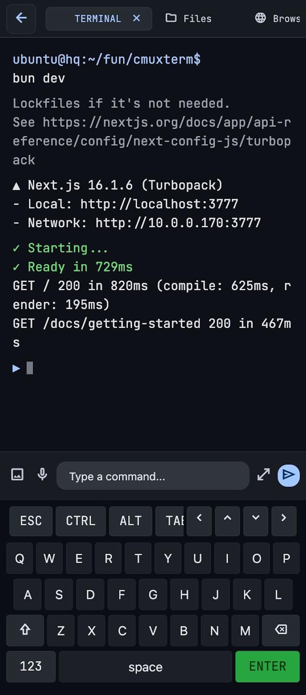
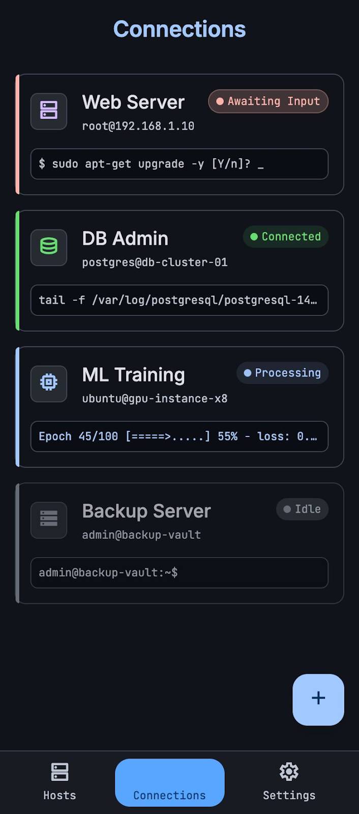
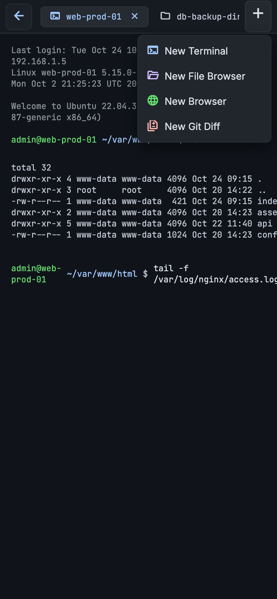
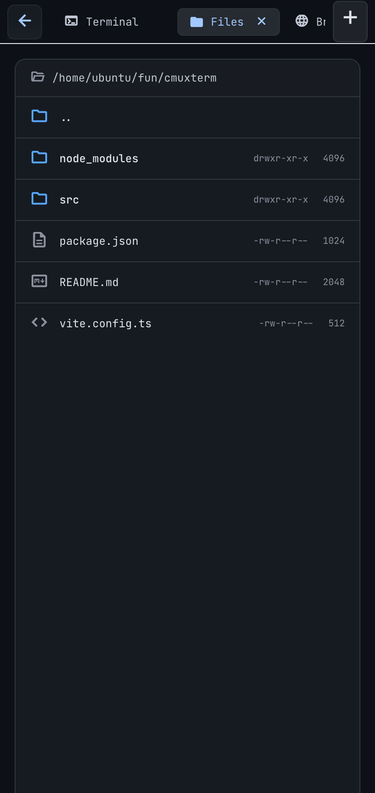
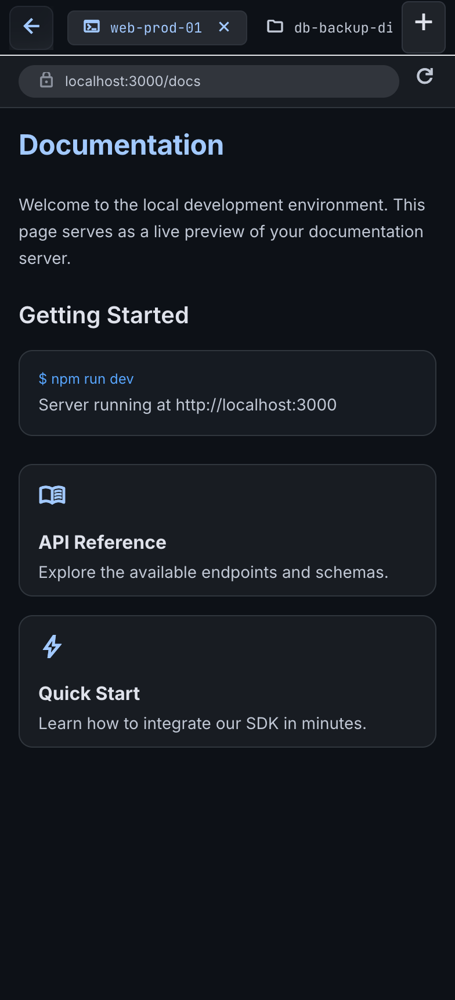
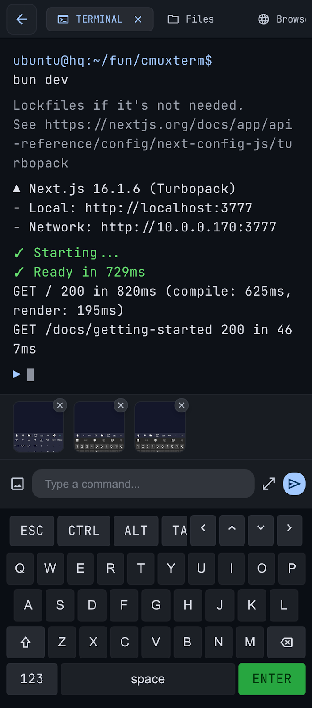

<p align="center">
  
</p>

<h1 align="center">AItty</h1>

<p align="center">
  A mobile-first terminal for coding.<br>
  SSH into your dev box from your phone and code from anywhere.
</p>

<p align="center">
  <a href="LICENSE"></a>
  
  
  
  <a href="https://msebindavis.github.io/AItty/"></a>
</p>

<p align="center">
  <a href="#features">Features</a> ·
  <a href="#screenshots">Screenshots</a> ·
  <a href="#getting-started">Getting started</a> ·
  <a href="#for-contributors">Contributors</a> ·
  <a href="https://msebindavis.github.io/AItty/">Website</a> ·
  <a href="CONTRIBUTING.md">Contributing</a>
</p>

<p align="center">
  
</p>

---

## What is AItty?

AItty is a **mobile-first terminal for coding**. Instead of a stripped-down SSH client, it gives you a full workspace on your phone: connect to a remote Linux dev box over SSH and get a real terminal, a file browser (SFTP), an in-app browser tunneled over a forwarded port, and a git diff view — all as tabs in one per-host workspace. A mobile-optimized input bar puts terminal modifier keys (ESC / CTRL / ALT / TAB / arrows) under your thumb, an expandable multi-line editor handles longer commands, and multimodal input (image upload + voice dictation) feeds an AI assistant pipeline so you can reason about what's on screen without typing a novel.

It's built for the moments you're away from your laptop but want to keep coding, debug a service, or review a diff — a calm, premium-feeling pro tool rather than a neon hacker toy.

> The full product spec lives in [REQUIREMENTS.md](REQUIREMENTS.md).

## Features

- **Hosts** — an SSH address book with secure password/key storage (`flutter_secure_storage`), groups, search, recents, and online/offline status. Known-host fingerprint pinning with mismatch warnings.
- **SSH terminal** — `dartssh2` shell + PTY rendered by a [vendored `xterm` fork](#vendored-xterm-fork), with ANSI color, scrollback, scroll-lock, line wrapping, and a 60fps render target.
- **Mobile-friendly input** — custom modifier accessory bar (ESC / CTRL / ALT / TAB / arrows, sticky CTRL/ALT), expandable full-screen multi-line command editor with special-character rows (Home / PgUp / PgDn / End / `|\?`), and command history (up/down).
- **Connections dashboard** — live per-session state machine (connected / processing / awaiting-input / idle / disconnected) with colored accent bars and a live last-output preview line.
- **Workspace tabs** — per-host workspaces compose multiple tabs: Terminal, SFTP **file browser**, in-app **WebView** (over a local port forward), and **git diff**. Add / close / switch tabs from a horizontally scrollable tab bar.
- **SFTP file browser** — directory listings with Unix permission strings + sizes, breadcrumb navigation, and a remote start-directory picker for new sessions.
- **In-app browser** — point a WebView at forwarded localhost ports to preview dev servers, docs, or services running on the host.
- **SSH key manager** — import `.pem` / private key files, stored in OS secure storage.
- **Multimodal AI input** *(in progress)* — attach images (camera/gallery) and dictate via `speech_to_text`, feeding an assistant pipeline.
- **Themes** — the "Obsidian Deep" dark design system (Inter for UI, JetBrains Mono for the terminal).

### Roadmap

Phase 1–5 of the [delivery roadmap](REQUIREMENTS.md#10-delivery-roadmap) (Foundation, Hosts, Connect, Sessions, Workspace tabs) are implemented. In progress / pending:

- **Phase 6 — Power input & AI:** image upload preview, voice dictation, assistant pipeline wiring.
- **Phase 7 — Hardening:** biometric / app-lock gate, host-key verification hardening, reconnect / keep-alive, perf tuning.

Non-goals for the initial release (see [REQUIREMENTS §2](REQUIREMENTS.md)): full desktop IDE parity, team sharing/collaboration, server provisioning / cloud-provider API integration, and a custom soft keyboard (AItty relies on the OS keyboard + the modifier bar).

## Screenshots

<p float="left">
  
  
  
  
  
  
</p>

> See the [website](https://msebindavis.github.io/AItty/#screenshots) for a full gallery.

## Getting started

AItty is a Flutter app. There's no published app-store build yet — build it from source.

### Prerequisites

- Flutter (stable channel), Dart `^3.12.0` — see [flutter.dev](https://docs.flutter.dev/get-started/install)
- For Android/iOS: the relevant platform toolchain + a device or emulator
- For a quick look with no mobile setup: Chrome (web) or macOS (desktop)

### Build & run

```bash
flutter pub get
flutter run -d chrome        # web (quickest, no toolchain)
flutter run -d macos         # desktop
flutter run -d <device-id>   # Android / iOS device or emulator
```

### Release builds

```bash
flutter build apk --release        # Android
flutter build ipa --release        # iOS
flutter build macos --release      # macOS
flutter build web --release        # web
```

## For contributors

Quick setup — see [CONTRIBUTING.md](CONTRIBUTING.md) for the full guide:

```bash
flutter pub get
flutter run -d chrome          # or macos / a device
flutter analyze                # must be clean
flutter test                   # smoke + model tests
```

Before opening a PR, run `flutter analyze` and `flutter test`, keep commits focused, and read [CONTRIBUTING.md](CONTRIBUTING.md) (architecture, the vendored `xterm` fork, code style, security notes).

### Vendored `xterm` fork

AItty ships a patched copy of [`xterm.dart`](https://github.com/TerminalStudio/xterm.dart) at [`packages/xterm`](packages/xterm), wired in via `dependency_overrides` in `pubspec.yaml`. Edits to the terminal emulator itself happen there, not in the published package. Keep its LICENSE intact. See [CONTRIBUTING.md](CONTRIBUTING.md#vendored-xterm-fork) for details.

## Project structure

```
lib/
  core/theme/          # Obsidian Deep design tokens (colors, typography)
  models/              # Host, Session, Workspace, WorkspaceTab, SshKey, …
  services/            # SSH (dartssh2), SFTP, sessions, secure storage, repositories
  providers/           # Riverpod notifiers
  features/            # Screens: hosts, connections, workspace, settings, shell
  router/              # go_router navigation (StatefulShellRoute bottom nav)
  utils/               # Helpers: git parsers, speech dictation, terminal input, …
  widgets/             # Shared UI components
packages/
  xterm/               # Vendored, patched xterm.dart terminal emulator
test/                  # widget_test.dart (smoke) + aitty_config_test.dart
docs/                  # Marketing website (GitHub Pages)
```

State management is [Riverpod](https://riverpod.dev) (`ProviderScope` at the root, `AsyncNotifier`s); routing is [go_router](https://pub.dev/packages/go_router). Entry point: `lib/main.dart` → `lib/app.dart`.

## Contributing

Contributions are welcome! Please read [CONTRIBUTING.md](CONTRIBUTING.md) and our [Code of Conduct](CODE_OF_CONDUCT.md). For big changes, open an issue to discuss the approach first.

## License

[MIT](LICENSE) © 2026 msebindavis